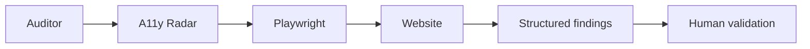

# A11y Radar

### Accessibility Audit Support Tool


> Automate the search. Keep the decision human.

A11y Radar is a private project designed to support web accessibility audits by accelerating information gathering and highlighting potential issues for human review.

It uses Playwright to inspect websites and produce structured findings. It does not replace human audits, automatically determine WCAG conformance or make the final accessibility decision.

## The Problem

Accessibility audits involve repeated inventory, measurement and evidence-gathering tasks.

A11y Radar supports this work by organising observations into findings that an auditor can review, investigate and confirm in context.

## How It Works



The auditor defines the audit scope. Playwright performs browser-based checks, and A11y Radar organises the observations for review.

Codex supports development and interaction with the project. Playwright executes the browser checks; the human auditor interprets the findings and makes the final decision.

## Current Modules

| Module | Purpose |
| --- | --- |
| PDF inventory / text extractability | Identify PDF resources and flag text-extractability observations for further review. |
| Forms inventory | Collect an overview of forms and controls to support manual accessibility assessment. |
| Media player detection | Identify potential media players for review of their accessibility features. |
| 4.1 — Long pages / internal index support | Flag long pages and observations about internal navigation or index support. |
| 4.2 — Mobile layout / horizontal overflow support | Surface layout and horizontal-overflow observations at mobile viewport sizes. |
| 5.2 — Interactive target size checks | Collect target-size measurements and flag potential issues for contextual review. |

The numbered labels above refer to project audit modules, not WCAG success criterion identifiers.

## Validation Philosophy

- Deterministic checks can be automated.
- Ambiguous findings are flagged for manual validation.
- Measurements and observations are evidence, not automatic conclusions.
- The auditor considers context, applicable requirements and exceptions.
- The auditor makes the final decision.

A flagged finding does not, by itself, establish an accessibility failure.

## Example Output

The following examples are fictional and illustrative. They contain no client data, real website URLs or private project output.

### Interactive target review

```text
Criterion 5.2 — project audit label
Element: Search button
Measured size: 40 × 40 CSS px
Status: Possible issue — manual validation required
```

### Long-page review

```text
Criterion 4.1 — project audit label
Page: Example page
Viewport 390 × 844 CSS px: Long
Viewport 320 × 800 CSS px: Long
Index detected: No
Status: Possible issue — manual validation required
```

These examples illustrate the review process, not a compliance verdict.

## Tech Stack

- **Browser automation:** Playwright
- **Language and runtime:** JavaScript, Node.js
- **Development tools:** GitHub, VS Code
- **Development support:** Codex / OpenAI

## Project Status

**Active development — functional prototype with modules validated against selected real-world audit scenarios.**

Module validation is limited to the scenarios assessed during development. It does not establish general detection accuracy or WCAG conformance.

The project is still evolving. This showcase describes its current scope and intended direction.

## Roadmap

Planned improvements:

- Human confirmation workflow
- Issue and evidence draft generation
- Local web interface
- Report and export improvements

Roadmap items are planned capabilities, not completed features.

## Source Code

The source code is private. This repository is a public showcase of the project architecture, capabilities and development progress.

It contains documentation only. Implementation details, detection logic, internal rules and private audit data are not published.

## Author

**Thayrine Souza**  
QA Automation Engineer | SDET | Web Accessibility

[LinkedIn](https://www.linkedin.com/in/thayrine-souza-6a3089341/) · [GitHub](https://github.com/Tfssouza)
